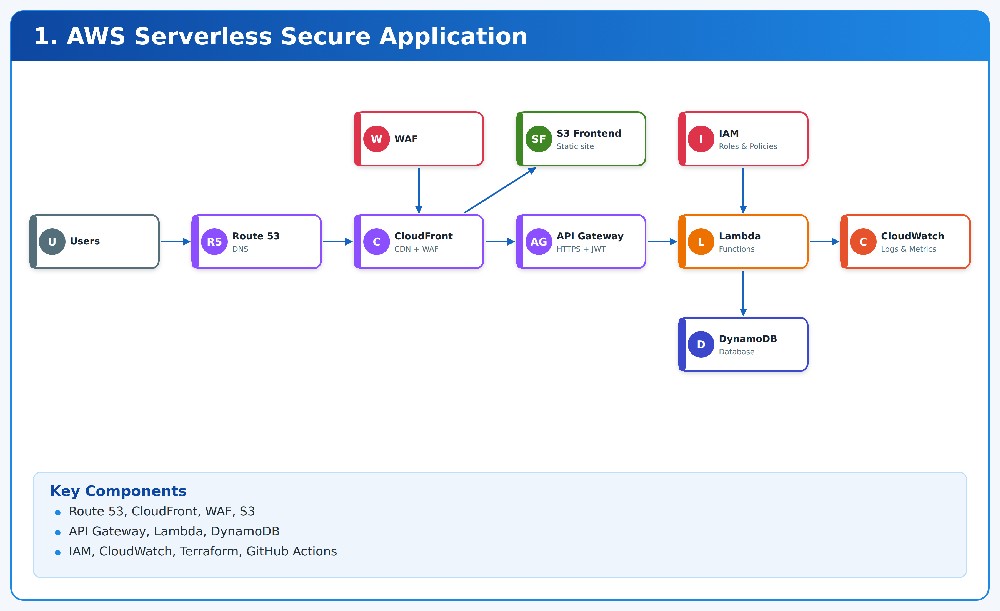
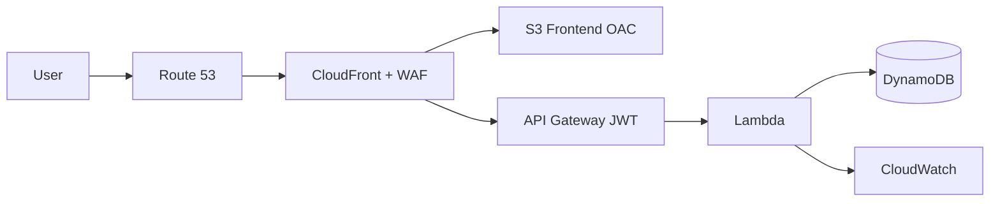

# 01. Secure AWS Serverless Application Platform



**AWS · Terraform · GitHub Actions** · *Phase 3 — Serverless specialization (Flagship 1)* · `lab` — verify before production use.

> Task-management API + static frontend on API Gateway, Lambda, DynamoDB, S3, CloudFront, Route 53, WAF — Terraform + GitHub Actions. Free-tier-conscious demo, not guaranteed free.

## Contents

1. [What you will build](#1-what-you-will-build)
2. [Architecture](#2-architecture)
3. [Prerequisites](#3-prerequisites)
4. [Repository map](#4-repository-map)
5. [Step 0 — Clone and hygiene](#step-0--clone-and-hygiene)
6. [Step 1 — Run the API locally (zero AWS)](#step-1--run-the-api-locally-zero-aws)
7. [Step 2 — Auth to AWS](#step-2--auth-to-aws)
8. [Step 3 — Configure variables](#step-3--configure-variables)
9. [Step 4 — Terraform init / plan / apply](#step-4--terraform-init--plan--apply)
10. [Step 5 — Deploy Lambda + frontend](#step-5--deploy-lambda--frontend)
11. [Step 6 — Verify end to end](#step-6--verify-end-to-end)
12. [Step 7 — CI/CD](#step-7--cicd)
13. [Step 8 — Operations, security, cost](#step-8--operations-security-cost)
14. [Step 9 — Teardown](#step-9--teardown)
15. [Troubleshooting](#troubleshooting)

## 1. What you will build

- DynamoDB table `task-api-tasks` (PAY_PER_REQUEST, `pk` hash key) — see `terraform/main.tf`.
- Private S3 frontend bucket + CloudFront + OAC pattern (lab creates bucket; attach CDN per `docs/architecture.md`).
- Python Lambda `app/lambda_handler.py` returning JSON tasks; JWT + throttling at API Gateway in full design.
- WAF managed rules as separate documented config (`enable_waf=true` by default, costs money).
- Budgets alert `$10` monthly lab guardrail. Never treat alert as hard cap.
- CI: `ci` + `terraform` (fmt/validate/plan) + `security` (Trivy, gitleaks).

## 2. Architecture



Full diagram: `docs/architecture.png` · Decisions: `docs/architecture.md` · Costs: `docs/cost-estimate.md`

Realtime flow:

1. Browser → Route 53 → CloudFront (TLS, cache, WAF inspect).
2. `/` → S3 origin via OAC (bucket never public). `/api/*` → API Gateway (JWT authorizer + throttle 100 rps lab).
3. Lambda validates input, reads/writes DynamoDB with least-privilege IAM, emits structured JSON logs.
4. CloudWatch logs/metrics/alarms (Lambda errors, throttles, DynamoDB user errors).

## 3. Prerequisites

| Tool | Version | Install (macOS) | Install (Ubuntu) |
|---|---|---|---|
| git, make | any | `xcode-select --install` | `sudo apt install -y git make` |
| python | 3.11+ | `brew install python` | `sudo apt install -y python3 python3-pip` |
| terraform **or** tofu | >=1.6 | `brew install terraform` | see releases |
| awscli | v2 | `brew install awscli` | see AWS docs |
| jq | any | `brew install jq` | `sudo apt install -y jq` |

AWS account with programmatic access. Read `docs/cost-estimate.md` first. Domain optional for first deploy.

## 4. Repository map

```
app/lambda_handler.py        # Task API Lambda (lab)
app/frontend/index.html      # Static frontend
app/requirements.txt         # pytest (if present)
terraform/versions.tf        # provider pin
terraform/variables.tf       # region, project, domain_name, enable_waf
terraform/main.tf            # DynamoDB + S3 + Budgets (lab scope)
terraform/outputs.tf         # table + bucket outputs
tests/test_lambda.py         # unit test
tests/smoke.sh               # hygiene smoke
monitoring/README.md         # where dashboards/rules live
runbooks/DEPLOYMENT.md|ROLLBACK.md|INCIDENT.md|RECOVERY.md
.github/workflows/ci.yml|terraform.yml|security.yml
```

## Step 0 — Clone and hygiene

```bash
git clone https://github.com/navin-kumar10/aws-serverless-secure-platform.git
cd aws-serverless-secure-platform
bash tests/smoke.sh
# expected: [smoke] OK (lab)
python3 -m py_compile app/lambda_handler.py && echo compile-ok
```

## Step 1 — Run the API locally (zero AWS)

```bash
python3 -c "from app.lambda_handler import handler; import json; print(json.dumps(handler({}, None), indent=2))"
# expected statusCode 200 with tasks list
python3 -m pytest tests/test_lambda.py -v  # if pytest installed
# serve frontend locally:
python3 -m http.server 8000 --directory app/frontend &
curl -s http://localhost:8000/ | head -5
kill %1
```

## Step 2 — Auth to AWS

```bash
aws sts get-caller-identity
# expected: Account, UserId, Arn
export AWS_REGION=us-east-1
echo $AWS_REGION
```

If SSO: `aws sso login --profile lab && export AWS_PROFILE=lab`.

## Step 3 — Configure variables

```bash
cat terraform/variables.tf
# region=us-east-1, project=task-api, domain_name="" (leave empty first deploy), enable_waf=true
# For cheapest first deploy, override WAF off:
cat > terraform/lab.auto.tfvars <<'VARS'
project    = "task-api"
enable_waf = false
VARS
cat terraform/lab.auto.tfvars
rm terraform/lab.auto.tfvars  # remove before commit; example only
```

Keep `domain_name=""` until you own a hosted zone. WAF is documented separately because ACL + rules + requests cost.

## Step 4 — Terraform init / plan / apply

```bash
terraform -chdir=terraform init
terraform -chdir=terraform fmt -check
terraform -chdir=terraform validate
terraform -chdir=terraform plan -out=tfplan
# READ every line: DynamoDB table, S3 bucket, Budgets. Estimate cost. No domain/WAF in lab scope.
terraform -chdir=terraform apply tfplan
terraform -chdir=terraform output
# expected: dynamodb_table="task-api-tasks", frontend_bucket="task-api-frontend-lab"
```

OpenTofu equivalent: replace `terraform` with `tofu`.

## Step 5 — Deploy Lambda + frontend

Lab scope provisions data + storage. Wire compute in this order for full design:

1. Zip Lambda: `zip -j function.zip app/lambda_handler.py`
2. Create least-privilege role (DynamoDB Put/Get/Query on table only + CloudWatch logs) — do in console or extend `terraform/main.tf`.
3. Create Lambda `task-api-lab` (python3.12, handler `lambda_handler.handler`), test in console.
4. Create HTTP API Gateway → `GET /api/tasks` → Lambda, attach JWT authorizer, throttle `100/200`.
5. Upload `app/frontend/index.html` to S3 bucket from outputs, attach CloudFront with OAC, point custom domain later.

Record ARNs/URLs in release notes.

## Step 6 — Verify end to end

```bash
terraform -chdir=terraform output
aws dynamodb describe-table --table-name task-api-tasks --query 'Table.TableStatus'
aws s3 ls s3://task-api-frontend-lab/
# after Gateway wired:
curl -s https://<api-id>.execute-api.us-east-1.amazonaws.com/api/tasks | head -c 300
bash tests/smoke.sh
```

CloudWatch: check `/aws/lambda/task-api-lab` for structured logs, create alarm on `Errors > 0 / 5min`.

## Step 7 — CI/CD

- `.github/workflows/ci.yml`: hygiene on PR/push (`README`, `docs/` present).
- `.github/workflows/terraform.yml`: triggers on `terraform/**` — fmt, init, validate (extend with `plan` artifact).
- `.github/workflows/security.yml`: Trivy fs + gitleaks weekly + PR.

Realtime PR flow:

1. Branch → edit Lambda or TF → `bash tests/smoke.sh` locally.
2. Push → open PR → required checks must pass.
3. `terraform plan` output reviewed → merge → staging apply → smoke → manual approval → prod apply.
4. Tag: `git tag v0.1.0 && git push --tags`.

Enable branch protection: require `validate`, `tf`, `scan`.

## Step 8 — Operations, security, cost

- IAM: Lambda role scoped to single table; no `*`. OIDC in CI, no long-lived keys.
- Input validation in handler; API throttling; TLS only; S3 Block Public Access ON.
- Scans block on CRITICAL/HIGH — see `SECURITY.md`.
- Cost: review `docs/cost-estimate.md` before every apply. Budgets mail is warning only. Domain + WAF + API requests are the surprise charges.

## Step 9 — Teardown

```bash
terraform -chdir=terraform destroy
aws dynamodb list-tables | grep task-api || echo "table gone"
aws s3 ls | grep task-api || echo "buckets gone"
# console check: API GW, Lambda, CloudFront, WAF ACL, Route53 zone, Budgets
```

## Troubleshooting

| Symptom | Cause | Fix |
|---|---|---|
| `Unable to locate credentials` | no AWS auth | `aws sts get-caller-identity`, set `AWS_PROFILE` |
| `BucketAlreadyExists` | global S3 name taken | change `project` var |
| `AccessDenied dynamodb` | Lambda role too narrow/wide | scope to table ARN, check `terraform/main.tf` |
| WAF bill surprise | ACL + rules metered | disable `enable_waf=false` for first lab, read `docs/cost-estimate.md` |
| Smoke fail | missing docs | `bash tests/smoke.sh`, check filenames |

## Portfolio link

Build 01 + 02 first for cohesive serverless + observability story. Order: Phase 1 (04,07,09) → Phase 2 (03,04,05) → Phase 3 (01) → Phase 4 (02) → Phase 5 (08,09,10). MIT — see LICENSE.
